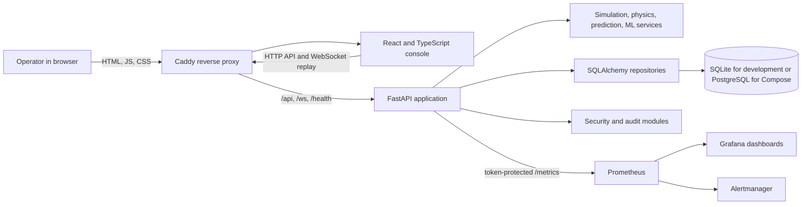
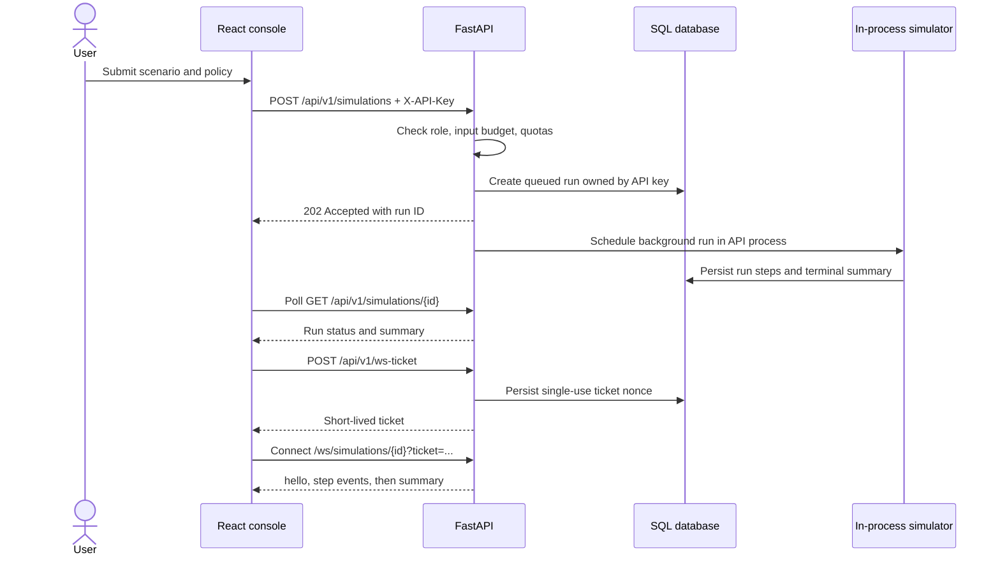
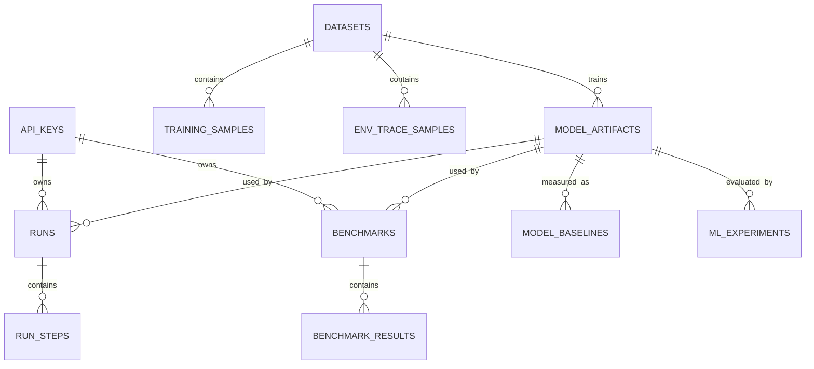

<div align="center">

# EntangleOps

**A research-oriented control plane and digital twin for quantum networks sharing fiber with classical traffic.**

Explore metro topologies, simulate link conditions and allocation policies, compare outcomes, and inspect model and system telemetry through a browser console.

</div>

> **Scope:** EntangleOps is a software simulation and research workbench. Its analytic physics are illustrative, are not calibrated to a specific experiment, and do not provide a quantum-security guarantee or control physical network equipment.

## Contents

- [Overview and status](#overview-and-status)
- [Features](#features)
- [Architecture](#architecture)
- [Technology stack](#technology-stack)
- [Repository layout](#repository-layout)
- [Prerequisites and setup](#prerequisites-and-setup)
- [Configuration](#configuration)
- [Using the console](#using-the-console)
- [HTTP and WebSocket API](#http-and-websocket-api)
- [Database](#database)
- [Testing and quality](#testing-and-quality)
- [Security and operational limits](#security-and-operational-limits)
- [Deployment](#deployment)
- [Known limitations and roadmap](#known-limitations-and-roadmap)
- [Contributing](#contributing)
- [License and acknowledgments](#license-and-acknowledgments)
- [Accuracy and testing-gap reports](#accuracy-and-testing-gap-reports)

## Overview and status

EntangleOps models a metro-scale network in which quantum links share fiber with classical traffic. Its FastAPI service calculates illustrative link quality, generates reproducible traffic and environmental traces, simulates static and adaptive allocation policies, and persists run history. A React console provides topology, scenario, run, benchmark, prediction, model, and administration views.

The repository also contains an ML workbench for synthetic Werner-fidelity prediction and a separately trained SLATE-PTP one-way delay model. Prometheus, Grafana, Alertmanager, and Caddy configuration are provided for a single-host Compose deployment.

The project is an active research prototype. There is no published release, live demo URL, license file, or evidence of production-scale, penetration, or physical-network validation in this repository.

## Features

### Simulation and analysis

- Two built-in network presets: a six-node metro topology and a three-node small topology.
- Analytic C-band and O-band link estimates using distance, classical load, temperature trend, and wind inputs.
- Seeded environment and request generation for repeatable runs.
- Static C-band, static O-band, adaptive, and calibrated adaptive-risk policies.
- Simulation run status, summaries, persisted time series, and browser replay.
- Benchmarks compare the three baseline policies against a shared seeded environment and request set. Adaptive-risk benchmark rows are reported separately by risk level.
- Prediction endpoint for Werner parameter and derived fidelity; calibrated intervals are available only when the loaded model has calibration for the requested alpha.

### Models and datasets

- Python CLI workflows build synthetic datasets, train/evaluate/tune models, record experiment evidence, produce reports/cards, and attempt gated promotion or rollback.
- Model metadata, digests, candidate/champion state, and experiments are stored in the database. Signed model files and sidecars live on disk.
- The browser Models view reads model and experiment metadata. Training and promotion are CLI operations; no HTTP training, reload, or promotion endpoint is implemented.
- A separate included SLATE-PTP model estimates measured one-way PTP delay from run conditions and up to five recent measurements of the same message type. It is not the simulator's Werner-fidelity predictor. The model card reports held-out-run validation; broader generalization is not established.

### Access, persistence, and monitoring

- API keys are stored as peppered HMAC digests and assigned `viewer`, `operator`, or `admin` roles. Run and benchmark reads are scoped to the owning key.
- SQL persistence covers runs and steps, benchmarks and results, keys, audit entries, WebSocket ticket nonces, datasets, model artifacts, baselines, and ML experiments.
- Prometheus metrics, JSON request logs, liveness/readiness endpoints, Grafana dashboards, alert rules, and an Alertmanager configuration are included.
- The browser has an optional local mock/demo mode. Demo responses are synthetic fixtures and are not live API data.

The [accuracy report](docs/README_ACCURACY_SUMMARY.md) classifies significant features and calls out repository inconsistencies. This list describes code presence, not proof that every workflow has passed end-to-end validation.

For status, “implemented” means the code path exists and has supporting repository evidence; it does not mean every feature has passed an end-to-end test. Adaptive-risk operation depends on a calibrated model, SeQUeNCe is unavailable, model lifecycle actions are CLI-only, and physical-network behavior is outside what this code can verify.

## Screenshots and demo

No screenshots or GIFs are tracked in the repository, and no hosted demo URL is verified. The frontend provides a local synthetic mock mode via `npm run dev:demo`; it is useful for UI exploration but does not demonstrate a live backend or persisted data. Add screenshots here when maintainers capture and review real project screens.

## Architecture

EntangleOps is a **single application service** with a static browser frontend and optional single-host infrastructure containers. The Compose files do not define independently scaled application microservices.



The main browser workflow starts an authenticated run, stores its state in SQL, polls for completion, and then replays persisted steps through a short-lived WebSocket ticket:



Runs execute as in-process background tasks; there is no external task queue. PostgreSQL or SQLite persists run state, but worker semaphores, rate-limit buckets, and WebSocket connection counters are process-local. A server restart can mark queued/running records interrupted; it does not resume those computations.

### Main component responsibilities

| Component               | Responsibility                                                                                                                      |
| ----------------------- | ----------------------------------------------------------------------------------------------------------------------------------- |
| `frontend/src/`         | React pages, API validation/adapters, API-key session, query cache, charts, topology rendering, and run replay.                     |
| `backend/app/api/`      | Versioned REST endpoints, ML endpoints, and ticketed WebSocket replay.                                                              |
| `backend/app/core/`     | Topology, analytic physics, environment/request generation, policies, simulator, and fidelity predictor.                            |
| `backend/app/services/` | Run/benchmark orchestration and ML service integration.                                                                             |
| `backend/app/db/`       | SQLAlchemy models, engine/session helpers, migration utilities, and repositories.                                                   |
| `backend/app/ml/`       | Feature building, training/serving, calibration, drift, caching, and model payloads.                                                |
| `machine_learning/`     | Standalone training/evaluation/data CLIs, ML tests, PTP predictor, reports, and model artifact.                                     |
| `security/`             | API-key auth, roles, audit chain, input/security middleware, rate limits, ticket handling, model integrity, and startup validation. |
| `monitoring/`           | Prometheus metrics, health endpoints, JSON logging, alert rules, Grafana provisioning, and periodic in-process checks.              |
| `database/migrations/`  | Alembic schema history and PostgreSQL-specific grants/triggers.                                                                     |

## Technology stack

| Area                | Technology                                                   | Actual role                                                                                                                                       |
| ------------------- | ------------------------------------------------------------ | ------------------------------------------------------------------------------------------------------------------------------------------------- |
| Backend language    | Python 3.11+                                                 | API, simulator, ML workflows, database tooling, monitoring, and security.                                                                         |
| API                 | FastAPI, Pydantic 2, Uvicorn                                 | Typed HTTP and WebSocket application; request validation and ASGI server.                                                                         |
| Frontend            | React 18, TypeScript 5, React Router                         | Single-page browser console and navigation.                                                                                                       |
| UI/data             | Tailwind CSS, Recharts, Lucide, React Query, Zustand, Zod    | Styling, charts/icons, server-state caching, small client stores, and API schema validation.                                                      |
| Persistence         | SQLAlchemy 2, Alembic, SQLite, PostgreSQL 16, Psycopg 3      | Relational persistence, migrations, local development DB, and Compose DB.                                                                         |
| Simulation          | NumPy, SciPy, NetworkX                                       | Numeric modeling, scientific calculations, and graph/path operations.                                                                             |
| ML                  | scikit-learn, Joblib, NumPy                                  | Synthetic Werner-fidelity model training and serving. The bundled PTP model uses a NumPy artifact.                                                |
| Observability       | `prometheus-client`, Prometheus, Grafana, Alertmanager       | Application metrics, scraping, dashboards, and configured alert routing. The default Alertmanager receiver is a placeholder.                      |
| Edge/proxy          | Caddy 2; Nginx unprivileged frontend image                   | TLS/reverse proxy configuration and static asset serving in Compose.                                                                              |
| Frontend build      | Node.js 20 in CI, npm, Vite, TypeScript, ESLint              | Dependency installation, dev server, lint/type checking, and production bundle.                                                                   |
| Tests               | pytest, Vitest, Testing Library, jsdom                       | Python backend/ML tests and frontend unit/component utility tests. No tracked Playwright E2E specs were found.                                    |
| CI/security tooling | GitHub Actions, Ruff, Bandit, pip-audit, Gitleaks, npm audit | Workflow checks, static/security scans, dependency audit, and secret scanning. CI commands include an ML test-path inconsistency described below. |
| External services   | None required by application code                            | Optional SeQUeNCe integration is currently an unavailable stub; no live external API client is implemented.                                       |

## Repository layout

```text
.
├── backend/              FastAPI app, scripts, tests, Dockerfile, and backend docs
├── database/             Alembic config, migrations, PostgreSQL initialization, restore drill
├── frontend/             React/TypeScript console, tests, and static-server config
├── machine_learning/     ML scripts, tests, docs, PTP model, and reports
├── monitoring/           Prometheus, Grafana, Alertmanager, metrics, health, and tasks
├── security/             API-key security, audit, middleware, and model verification
├── docker-compose*.yml   Application, database, and monitoring Compose definitions
└── .github/workflows/    Frontend quality and security CI workflows
```

There is no root README or license file in the original tracked tree; this document is the project README. Generated data, database secrets, local env files, runtime model files, and frontend build output are excluded by `.gitignore`.

## Prerequisites and setup

### Local development

- Python 3.11 or newer and pip.
- Node.js and npm compatible with the frontend lockfile; CI uses Node.js 20.
- Git.
- SQLite is the default local database and requires no separate server.

From the repository root:

```bash
git clone https://github.com/axorarbxy/EntangleOps.git
cd EntangleOps
python -m venv .venv
```

Activate the environment (`.venv\Scripts\Activate.ps1` in PowerShell, or `source .venv/bin/activate` on macOS/Linux), then install and start the backend:

```bash
python -m pip install -r backend/requirements-dev.txt
cd backend
python -c "import secrets; print(secrets.token_hex(32))"
```

For repeatable model signing, place the generated value in an ignored `backend/.env` as `EO_MODEL_SIGNING_KEY=<generated-value>`. The repo currently does **not** track a `backend/.env.example`; create the local file yourself and do not commit secrets. From `backend/`, start the service with:

```bash
uvicorn app.main:app --reload --port 8000
```

In another terminal, install and run the frontend:

```bash
cd frontend
npm ci
npm run dev
```

Open `http://localhost:5173`. Vite proxies `/api`, `/health`, and `/ws` to `http://localhost:8000`. The local development server uses SQLite at the configured `EO_DATABASE_URL` (default `sqlite:///./data/entangleops.db`) and can auto-apply migrations when `EO_DB_AUTO_MIGRATE=true`.

**Current host-side issue:** local app startup and ML persistence tests can fail at Alembic config discovery because `backend/app/db/migrate.py::_config()` resolves a different repository root on a host checkout than in the Docker image. The Compose migration path has been exercised; direct host startup should be considered blocked until that helper is corrected. See [known limitations](#known-limitations-and-roadmap).

The first local API key can be created from `backend/` after the API is configured:

```bash
python scripts/manage_keys.py create --name local-admin --role admin
```

Save the printed key: it is shown once. The browser login accepts an API key in the form `eo_<12-character-key-id>.<secret>`.

### Compose deployment

Docker Compose v2 and Docker Desktop (or a Docker Engine) are required. The full stack combines three tracked Compose files:

```bash
python backend/scripts/gen_db_secrets.py
python backend/scripts/gen_monitoring_secrets.py
```

Create an ignored `backend/.env` with production settings and generated secrets. At minimum configure distinct 32+ character values for `EO_API_KEY_PEPPER` and `EO_MODEL_SIGNING_KEY`, an explicit `EO_CORS_ORIGINS` allowlist, `EO_METRICS_TOKEN` matching the generated monitoring token, and the database secret-file settings used by the Compose overlay. Create a root `.env` with `GRAFANA_ADMIN_PASSWORD`; `EO_DOMAIN` defaults to `localhost`. Do not paste secret values into source control.

Then run from the repository root:

```bash
docker compose \
  -f docker-compose.yml \
  -f docker-compose.db.yml \
  -f docker-compose.monitoring.yml \
  up --build -d
```

The database overlay runs PostgreSQL, waits for the one-shot migration service, and then starts the API. The API connects as the least-privileged `eo_app` role; migration credentials are supplied only to the migration job. The monitoring overlay adds Prometheus, Grafana, and Alertmanager. The base Caddy configuration binds ports 80 and 443; change the proxy mapping if those host ports are already occupied.

The Compose database and monitoring volumes persist across restarts. Do not remove volumes as a routine troubleshooting step: deleting the PostgreSQL volume deletes its database. On a fresh deployment, create an admin key with:

```bash
docker compose -f docker-compose.yml -f docker-compose.db.yml -f docker-compose.monitoring.yml \
  exec backend python scripts/manage_keys.py create --name local-admin --role admin
```

The command prints the key once. API docs are available at `/docs` in development. In production, `EO_ENABLE_DOCS` must explicitly be `true` to expose OpenAPI/Swagger routes; otherwise docs are disabled.

### Useful service URLs

| Service                       | Default local URL                                            |
| ----------------------------- | ------------------------------------------------------------ |
| Browser console through Caddy | `http://localhost/` (or HTTPS on the configured TLS domain)  |
| API health                    | `/health/live`, `/health/ready` on the same host             |
| Prometheus                    | `http://127.0.0.1:9090`                                      |
| Alertmanager                  | `http://127.0.0.1:9093`                                      |
| Grafana                       | `http://127.0.0.1:3000` (`admin`, password from root `.env`) |

## Configuration

The backend reads `EO_`-prefixed settings from the process environment and `.env` in its working directory. The Compose root `.env` is also used for Compose interpolation (`GRAFANA_ADMIN_PASSWORD`, `EO_DOMAIN`). In production, the application rejects weak/missing signing and API-key secrets, unsafe CORS, invalid PostgreSQL roles/drivers, unsafe model-directory permissions, and some other insecure settings.

| Variable                                                                                | Purpose                                                                     |                                 Required? | Default or example                                                         |
| --------------------------------------------------------------------------------------- | --------------------------------------------------------------------------- | ----------------------------------------: | -------------------------------------------------------------------------- |
| `EO_ENV`                                                                                | Runtime mode and security policy                                            |                                        No | `development`; Compose sets `production`                                   |
| `EO_APP_NAME`                                                                           | Declared application label                                                  |                                        No | `EntangleOps`                                                              |
| `EO_DATABASE_URL`                                                                       | SQLAlchemy database URL                                                     |                                        No | `sqlite:///./data/entangleops.db`; Compose sets PostgreSQL                 |
| `EO_DATABASE_PASSWORD_FILE`                                                             | File containing runtime DB password                                         |                                   Compose | `/run/secrets/db_app_password`                                             |
| `EO_MIGRATION_DATABASE_URL`                                                             | Migration-only database URL                                                 |                             Migration job | `postgresql+psycopg://eo_owner@db:5432/entangleops`                        |
| `EO_MIGRATION_PASSWORD_FILE`                                                            | File containing migration DB password                                       |                             Migration job | `/run/secrets/db_owner_password`                                           |
| `EO_DB_AUTO_MIGRATE`                                                                    | Auto-migrate in non-production startup                                      |                                        No | `true`                                                                     |
| `EO_ALLOW_SQLITE_IN_PRODUCTION`                                                         | Explicit single-node SQLite exception                                       |                                        No | `false`                                                                    |
| `EO_DB_POOL_SIZE`, `EO_DB_MAX_OVERFLOW`                                                 | SQLAlchemy connection pool sizing                                           |                                        No | `5`, `5`                                                                   |
| `EO_DB_POOL_TIMEOUT_S`, `EO_DB_POOL_RECYCLE_S`                                          | Pool wait and recycle intervals                                             |                                        No | `10`, `1800`                                                               |
| `EO_DB_STATEMENT_TIMEOUT_MS`, `EO_DB_ECHO`                                              | DB timeout and SQL logging                                                  |                                        No | `5000`, `false`                                                            |
| `EO_API_KEY_PEPPER`                                                                     | Secret used for stored API-key HMAC digests                                 |                                Production | Generate an independent 32+ character secret                               |
| `EO_MODEL_SIGNING_KEY`                                                                  | Symmetric model artifact signing secret                                     |                                Production | Generate an independent 32+ character secret; keep stable                  |
| `EO_KEYS_PATH`, `EO_AUDIT_PATH`                                                         | Legacy file-path settings; current runtime stores keys/audit records in SQL |                                        No | `./data/keys.json`, `./data/audit.jsonl` (not the active persistence path) |
| `EO_CORS_ORIGINS`                                                                       | Allowed browser origins                                                     |                                Production | Explicit JSON list, e.g. `["https://console.example"]`                     |
| `EO_WS_ALLOWED_ORIGINS`                                                                 | WebSocket origin allowlist; falls back to CORS list                         |                                        No | `[]`                                                                       |
| `EO_ENABLE_DOCS`                                                                        | Enable OpenAPI/Swagger docs                                                 |                                        No | `true` in development; must explicitly opt in for production               |
| `EO_BEHIND_TLS`, `EO_TRUSTED_PROXY_COUNT`                                               | HSTS and trusted-proxy interpretation                                       |                                Deployment | `false`, `0`; base Compose sets TLS and one proxy                          |
| `EO_MAX_BODY_BYTES`                                                                     | Request body limit                                                          |                                        No | `65536`                                                                    |
| `EO_DATA_DIR`, `EO_MODEL_PATH`, `EO_ML_MODELS_DIR`                                      | Runtime data and model artifact paths                                       |                                        No | `./data`, `./data/predictor.joblib`, `./data/models`                       |
| `EO_DEFAULT_SEED`, `EO_DEFAULT_DT_S`, `EO_DEFAULT_DURATION_H`                           | Default simulation seed, step, and duration                                 |                                        No | `42`, `60`, `24`                                                           |
| `EO_FORECAST_HORIZON_STEPS`, `EO_SAFETY_MARGIN`, `EO_K_PATHS`                           | Predictor horizon, fidelity safety margin, and path count                   |                                        No | `5`, `0.01`, `4`                                                           |
| `EO_ENABLE_SEQUENCE`                                                                    | Optional SeQUeNCe switch                                                    |                                        No | `false`; adapter currently returns unavailable                             |
| `EO_MAX_CONCURRENT_RUNS`, `EO_MAX_QUEUED_RUNS`                                          | Process-local run concurrency and queue cap                                 |                                        No | `2`, `10`                                                                  |
| `EO_MAX_RUNS_PER_KEY_ACTIVE`, `EO_MAX_STORED_RUNS`                                      | Per-key quota and history cap                                               |                                        No | `3`, `200`                                                                 |
| `EO_RUN_TIMEOUT_S`, `EO_RUN_LEASE_S`                                                    | Run timeout and stale-run lease                                             |                                        No | `120`, `60`                                                                |
| `EO_MAX_STEPS_PER_RUN`, `EO_MAX_EXPECTED_REQUESTS_PER_RUN`                              | Simulation compute budgets                                                  |                                        No | `5760`, `20000`                                                            |
| `EO_MAX_STORED_BENCHMARKS`                                                              | Benchmark history cap                                                       |                                        No | `200`                                                                      |
| `EO_MAX_WS_PER_KEY`, `EO_WS_TICKET_TTL_S`                                               | WebSocket connection cap and ticket lifetime                                |                                        No | `3`, `30` seconds                                                          |
| `EO_RATE_PER_KEY_PER_MIN`, `EO_RATE_PER_IP_PER_MIN`, `EO_RATE_AUTH_FAIL_PER_IP_PER_MIN` | Process-local API rate limits                                               |                                        No | `120`, `240`, `10`                                                         |
| `EO_KEY_CACHE_TTL_S`                                                                    | API-key verification cache lifetime                                         |                                        No | `5`                                                                        |
| `EO_METRICS_ENABLED`, `EO_METRICS_TOKEN`                                                | Metrics switch and Prometheus bearer token                                  | Token required when enabled in production | `true`; independent 32+ character token                                    |
| `EO_LOG_LEVEL`, `EO_LOG_JSON`                                                           | Application log level and JSON formatting                                   |                                        No | `INFO`, `true`                                                             |
| `EO_SLOW_REQUEST_S`                                                                     | Slow request log threshold                                                  |                                        No | `2.0`                                                                      |
| `EO_DRIFT_SAMPLE_EVERY_STEPS`, `EO_DRIFT_EWMA_ALPHA`                                    | Predictor shadow-drift sampling                                             |                                        No | `10`, `0.05`                                                               |
| `EO_ML_RISK_ALPHA`                                                                      | Default risk-policy calibration alpha                                       |                                        No | `0.10` (allowed: `0.05`, `0.1`, `0.2`)                                     |
| `EO_ML_PREDICTION_CACHE_ROWS`                                                           | Per-run bounded prediction cache size                                       |                                        No | `50000`                                                                    |
| `EO_ML_PSI_WINDOW_ROWS`, `EO_ML_PSI_MIN_ROWS`                                           | Feature-drift window/minimum sample sizes                                   |                                        No | `2000`, `500`                                                              |
| `EO_AUDIT_VERIFY_INTERVAL_S`, `EO_LOOP_LAG_INTERVAL_S`, `EO_DB_MAINTENANCE_INTERVAL_S`  | In-process periodic check intervals                                         |                                        No | `300`, `0.5`, `30`                                                         |
| `EO_OTEL_ENABLED`, `EO_OTEL_ENDPOINT`                                                   | Optional OpenTelemetry configuration                                        |                                        No | `false`, empty; OpenTelemetry SDK is not in backend dependencies           |
| `GRAFANA_ADMIN_PASSWORD`                                                                | Grafana initial admin password (Compose interpolation)                      |                        Monitoring Compose | Set in root `.env`; never commit                                           |
| `EO_DOMAIN`                                                                             | Caddy site name                                                             |                             Compose proxy | `localhost`                                                                |
| `VITE_API_BASE`, `VITE_WS_BASE`                                                         | Frontend API and WebSocket bases                                            |                                        No | Empty means same-origin                                                    |
| `VITE_GRAFANA_URL`, `VITE_IDLE_MINUTES`, `VITE_DEMO_MODE`                               | Console dashboard link, idle timeout, and mock mode                         |                                        No | Empty, `30`, `false`                                                       |

`EO_API_KEY_PEPPER`, `EO_MODEL_SIGNING_KEY`, DB password files, `EO_METRICS_TOKEN`, and `GRAFANA_ADMIN_PASSWORD` are secrets. Never put real values in this README or commit local `.env`/secret files. `EO_METRICS_TOKEN` in the backend environment must match `monitoring/secrets/metrics_token` for Prometheus scraping.

## Using the console

1. Start the backend and frontend, or the Compose stack.
2. Create an API key with `backend/scripts/manage_keys.py` (or the in-app admin console when an admin key already exists).
3. Sign in with the key. The UI calls `GET /api/v1/me` to resolve its name and role.
4. Choose **Network** to inspect a built-in topology; use **Simulate** to configure a seed, topology, policy, duration, and scenario. Starting simulations requires an operator or admin role.
5. Open **Runs** to inspect persisted runs, their summaries, metrics, and replay. Run detail is available only to the owning key.
6. Use **Compare** and **Benchmarks** to submit and review seeded policy comparisons; submission requires operator/admin.
7. Use **Physics & predictor** for analytic previews and authenticated fidelity prediction. Use **Models** to read the current model and stored experiment records and to submit the PTP delay estimate.
8. **Admin** exposes key management, audit/health information, and the cross-check status to admin keys.

The role-based navigation hides actions that the current key cannot use. The front end validates API response shapes with Zod, uses React Query for server data, and stores the API key in the session store. The optional “remember” behavior uses browser `sessionStorage`, not a persistent account system.

## HTTP and WebSocket API

Most `/api/v1` endpoints use the `X-API-Key` header. Roles are hierarchical: viewer, operator, admin. API errors use appropriate HTTP codes for validation, auth/role failures, quotas, missing resources, and DB availability. Exact payload schemas are defined in `backend/app/schemas.py` and route modules; development OpenAPI docs are served at `/docs`.

| Method                  | Endpoint                                                | Purpose                                                  | Minimum role                       |
| ----------------------- | ------------------------------------------------------- | -------------------------------------------------------- | ---------------------------------- |
| `GET`                   | `/health`, `/health/live`, `/health/ready`              | Liveness/readiness                                       | Public                             |
| `GET`                   | `/api/v1/health`                                        | Legacy API health                                        | Public                             |
| `GET`                   | `/api/v1/me`                                            | Current API-key identity                                 | Viewer                             |
| `GET`                   | `/api/v1/topology?preset=metro\|tiny`                   | Read built-in topology                                   | Viewer                             |
| `POST`, `GET`           | `/api/v1/simulations`                                   | Start a run; list caller's runs                          | Operator to start; viewer to list  |
| `GET`                   | `/api/v1/simulations/{rid}`                             | Read an owned run                                        | Viewer                             |
| `GET`                   | `/api/v1/simulations/{rid}/timeseries`                  | Read persisted result columns/stride                     | Viewer                             |
| `POST`, `GET`           | `/api/v1/benchmarks`                                    | Submit a comparison; list caller's benchmarks            | Operator to submit; viewer to list |
| `GET`                   | `/api/v1/benchmarks/{bid}`                              | Read an owned benchmark                                  | Viewer                             |
| `POST`                  | `/api/v1/predict`                                       | Estimate Werner parameter/fidelity and optional interval | Viewer                             |
| `GET`                   | `/api/v1/crosscheck`                                    | Return SeQUeNCe cross-check status/stub                  | Admin                              |
| `POST`                  | `/api/v1/ws-ticket`                                     | Issue a one-use replay ticket for an owned run           | Viewer                             |
| `GET`                   | `/api/v1/ml/model`                                      | Read active model metadata                               | Viewer                             |
| `GET`                   | `/api/v1/ml/experiments`, `/api/v1/ml/experiments/{id}` | Read ML experiment records                               | Viewer                             |
| `POST`                  | `/api/v1/ml/ptp-delay`                                  | Predict one-way SLATE-PTP delay                          | Viewer                             |
| `GET`, `POST`, `DELETE` | `/api/v1/admin/keys[/{key_id}]`                         | List, create, or revoke API keys                         | Admin                              |
| `GET`                   | `/api/v1/admin/audit`                                   | Read audit events                                        | Admin                              |
| `GET`                   | `/api/v1/admin/health/details`                          | Read detailed backend checks                             | Admin                              |
| `GET`                   | `/metrics`                                              | Prometheus exposition                                    | Bearer metrics token when enabled  |
| WebSocket               | `/ws/simulations/{rid}?ticket=...`                      | Replay a completed owned run                             | One-use short-lived ticket         |

`POST /api/v1/simulations` and `POST /api/v1/benchmarks` return `202 Accepted`. Simulation requests reject unknown fields and non-finite values, validate numeric ranges, and enforce compute budgets. Cross-owner run access is returned as not found. The WebSocket ticket is bound to a key and run and can be redeemed once.

## Database

Alembic migrations `0001` and `0002` define the schema. The app uses SQLite for development and PostgreSQL 16 in the database Compose overlay. SQLite connections enable WAL and foreign-key checks. PostgreSQL migrations create a separate owner/runtime-role setup; the backend runtime should connect as `eo_app`, not the database owner.



Core tables are `api_keys`, `audit_log`, `runs`, `run_steps`, `benchmarks`, `benchmark_results`, `ws_ticket_nonces`, `datasets`, `training_samples`, `env_trace_samples`, `model_artifacts`, `model_baselines`, and `ml_experiments`. Constraints enforce roles, status/policy values, positive step counts, model schema/status, and selected ownership/reference rules. PostgreSQL uses an append-only audit trigger and explicit application grants. API-key secrets and WebSocket ticket strings are not stored as plaintext; only digests/nonces and related metadata are persisted.

Run state and result steps are persisted transactionally. Local filesystem model artifacts are separate from relational metadata and must live on persistent storage. A new Compose install initializes an empty database; no fixture population or default production API key is seeded automatically.

## Testing and quality

### Commands present in the repository

Backend commands run from `backend/`:

```bash
python -m pip install -r requirements-dev.txt
pytest -q tests
pytest -q ../machine_learning/tests/test_ml.py
ruff check .
python -m alembic -c ../database/alembic.ini upgrade head
python -m alembic -c ../database/alembic.ini check
```

The `backend/Makefile` also provides `make test`, `make lint`, `make db-upgrade`, `make db-check`, and ML workflow targets. Frontend commands run from `frontend/`:

```bash
npm ci
npm run lint
npm run typecheck
npm test
npm run build
npm run e2e
```

The `e2e` package script invokes Playwright, but no tracked Playwright configuration/specs were found. The `contract` script requires `EO_API_BASE` and `EO_API_KEY` and exercises `/me`, topology, a short simulation, summary, and time series against a running API. It is an API smoke/contract script, not a browser E2E suite.

### Existing test coverage and observed execution

| Suite/check                                   | What is present                                                                                                                        | Result during this documentation pass                                                                                                                                                                                       |
| --------------------------------------------- | -------------------------------------------------------------------------------------------------------------------------------------- | --------------------------------------------------------------------------------------------------------------------------------------------------------------------------------------------------------------------------- |
| Backend pytest                                | 30 tests across API, DB persistence, simulator/physics/topology/policies/predictor, security, and monitoring                           | Full `pytest -q backend/tests` attempt was interrupted without a final result. Targeted `backend/tests/test_physics.py`: **2 passed**.                                                                                      |
| ML pytest                                     | 7 tests for feature compatibility, causal features, datasets, conformal calibration, cache bounds, experiments, and registry promotion | **5 passed, 2 failed**: host execution raises `No 'script_location' key found in configuration` from `backend/app/db/migrate.py::_config`. The Docker migration runner succeeds because the container's path depth differs. |
| Frontend Vitest                               | 4 files covering budget rules, API adapters/schemas, and analytic physics helpers                                                      | **4 files, 11 tests passed**.                                                                                                                                                                                               |
| Frontend ESLint                               | ESLint over frontend source                                                                                                            | Passed.                                                                                                                                                                                                                     |
| Frontend TypeScript                           | `tsc -b --noEmit`                                                                                                                      | Passed.                                                                                                                                                                                                                     |
| Frontend production build                     | `tsc -b && vite build`                                                                                                                 | Passed.                                                                                                                                                                                                                     |
| Compose runtime smoke check                   | Full stack startup, DB readiness, backend health, root page                                                                            | During the prior runtime check, migration completed at head `0002`, backend was healthy, and the app and `/health/live` returned HTTP 200.                                                                                  |
| Full CI security workflow                     | Ruff, Bandit, pip-audit, backend tests, ML tests, dashboard generation, Prometheus rule check, Gitleaks                                | Not run as a complete workflow. It references a non-existent `backend/tests/test_ml.py`; the ML tests are under `machine_learning/tests/test_ml.py`.                                                                        |
| npm audit / browser E2E / external deployment | Configured in CI or package scripts where noted                                                                                        | Not run in this pass.                                                                                                                                                                                                       |

### Test matrix

“Existing” means there is a matching repository test, not that the test passed in this execution. Rows marked **Recommended** are proposed coverage, not implemented tests.

| Test ID | Category            | Scenario                                                                         | Expected result                                                    | Existing test?         | Verification method                                                         |
| ------- | ------------------- | -------------------------------------------------------------------------------- | ------------------------------------------------------------------ | ---------------------- | --------------------------------------------------------------------------- |
| U-01    | Unit                | Analytic link physics changes monotonically with distance/band and path swapping | Stable bounded estimates with expected degradation                 | Yes                    | `backend/tests/test_physics.py`                                             |
| U-02    | Unit                | Seeded simulation/environment generation is repeatable                           | Same seed produces same trace/results                              | Yes                    | `backend/tests/test_simulator.py`, `test_environment.py`                    |
| U-03    | Unit                | Invalid policy weights, NaN, and range violations                                | Request/config is rejected                                         | Yes                    | `backend/tests/test_sec_input_limits.py`                                    |
| U-04    | Unit                | Prediction feature building, conformal quantiles, bounded cache                  | Features preserve schema; cache stays bounded                      | Yes                    | `machine_learning/tests/test_ml.py`                                         |
| I-01    | Integration         | Run state, steps, keys, tickets, and audit survive DB engine restart             | Persisted rows remain queryable; ticket remains single-use         | Yes                    | `backend/tests/test_db_persistence.py`                                      |
| I-02    | Integration         | PostgreSQL migrations, owner/runtime grants, audit triggers                      | Fresh DB reaches head; app role has only required grants           | Partial                | Compose migration path exists; verify against disposable PostgreSQL in CI   |
| I-03    | Integration         | Model training/evaluation/promotion metadata and artifacts                       | Evidence binds to digest; failed gates cannot promote              | Yes                    | ML tests cover registry/gate behavior; add CLI-level file integration       |
| API-01  | API/security        | Missing, malformed, expired, or revoked API key                                  | `401`; repeated failures are rate limited                          | Yes                    | `backend/tests/test_sec_auth.py`, `test_sec_ratelimit_quota.py`             |
| API-02  | API/security        | Viewer attempts operator/admin actions                                           | `403`, no state change                                             | Partial                | Role helpers tested; expand route-by-route denial matrix                    |
| API-03  | API/ownership       | Caller reads another key's run/benchmark                                         | Not-found response, no data leak                                   | Yes for runs           | `backend/tests/test_sec_authz_idor.py`; add benchmark case                  |
| API-04  | API                 | Valid run, invalid payload, over-budget run, queue full                          | `202`, `422`, or `503`/`429` with bounded response                 | Partial                | API and validation tests; add endpoint contract table across all routes     |
| API-05  | API                 | PTP delay request boundaries and unavailable artifact                            | Valid estimate, `422`, or `503` with stable schema                 | Recommended            | Authenticated API integration test using packaged artifact                  |
| UI-01   | Frontend            | API schema adaptation and input-budget calculations                              | Correct normalized data and validation                             | Yes                    | `frontend/src/api/*.test.ts`, `frontend/src/lib/*.test.ts`                  |
| UI-02   | Frontend            | Login, role-gated navigation, loading/empty/error states                         | Correct role-specific UI and accessible feedback                   | No                     | Add Testing Library interaction tests                                       |
| UI-03   | Frontend            | Responsive layouts and keyboard/screen-reader flows                              | Usable at mobile/desktop sizes with accessible controls            | No                     | Add accessibility checks and browser tests                                  |
| E2E-01  | End-to-end          | Sign in, submit a tiny run, poll completion, inspect replay                      | Persisted run appears and replay ends with summary                 | Contract script only   | `npm run contract` with a running API/key; then add Playwright browser spec |
| SEC-01  | Security            | Injection/XSS, body limits, CORS, security headers, model tampering              | Rejected/escaped input, bounded body, verified signatures          | Partial                | Existing security tests; add route-level fuzz and browser tests             |
| SEC-02  | Security/operations | Secret leakage, dependency CVEs, migration isolation                             | No secrets in repo/logs; scans pass; runtime DB is least privilege | CI configured, not run | `gitleaks`, `pip-audit`, `npm audit`, role/grant integration test           |
| MON-01  | Monitoring          | Metrics auth, route-label cardinality, readiness, JSON redaction                 | Protected metrics and bounded, redacted telemetry                  | Yes                    | `backend/tests/test_mon_*.py`                                               |

### Recommended release gates

1. Install from the lockfile/requirements in a clean environment.
2. Fix the host-side migration config resolution and the ML test path in CI.
3. Run the complete backend, ML, and frontend suites; require a final successful result.
4. Run lint, type checking, production bundle, and dependency/security scans.
5. Start a disposable PostgreSQL Compose stack, apply migrations, verify `eo_app` access, and exercise authenticated run persistence/replay.
6. Complete at least one browser journey and check key role boundaries.
7. Establish measured model/monitoring baselines before interpreting provisional alert thresholds as operational objectives.

## Security and operational limits

Implemented controls include role-based API keys, per-key ownership queries, peppered key digests, startup security validation, request-size limits, CORS allowlists, request IDs/security headers, token buckets, run quotas, single-use WebSocket tickets, signed model artifacts, and an append-only/hash-chained audit table. The Docker app image is configured as non-root with a read-only root filesystem and dropped capabilities.

These controls do not amount to a security certification. API keys are shared credentials, not user accounts; there is no SSO or MFA. In-memory quotas and counters are per-process. The audit chain can detect edits/reordering but cannot prevent deletion of the whole database/log. The symmetric model signing key must be protected and stable. Do not expose Grafana, Prometheus, or the development API docs publicly without an explicit access-control plan.

Monitoring alerts include placeholder/provisional thresholds. Alertmanager's configured receiver sends no notifications until a real receiver is configured. No load test, penetration test, PostgreSQL restore drill, or production operational SLO is established by this repository.

## Deployment

The repository configures a single-host Docker Compose deployment: Caddy proxy, static Nginx frontend, FastAPI backend, PostgreSQL 16, a one-shot Alembic migration container, Prometheus, Grafana, and Alertmanager. Named volumes persist database, proxy, Grafana, and Prometheus state. Backend database passwords and metrics scrape token are mounted as Compose secrets; API-key and signing peppers come from backend environment configuration.

For a public deployment, provide a domain and trusted TLS setup, explicit browser/WebSocket origins, stable independent secrets, protected monitoring access, persistent and backed-up database/model storage, a configured Alertmanager receiver, and an operations-tested backup/restore procedure. The repository does not define a managed cloud host or automated production release process.

## Known limitations and roadmap

### Verified limitations

- Physics constants are illustrative; the simulator is not calibrated to a particular physical network.
- SeQUeNCe cross-check is an unavailable stub and always reports `available: false`.
- Run execution is an in-process Starlette background task; there is no durable work queue or cross-process coordination.
- Rate limits, worker slots, WebSocket counters, and ticket-use caches are not distributed.
- Model inference/training targets are synthetic for the Werner predictor. The separately measured PTP model has limited held-out-run evidence and no established out-of-domain guarantee.
- Model training, promotion, and rollback are CLI-only. UI model/experiment browsing is read-only.
- Host-side ML tests currently fail because Alembic config discovery resolves a different path than the repository root; the Compose container path has been exercised successfully. See the [accuracy report](docs/README_ACCURACY_SUMMARY.md).
- The security workflow points to `backend/tests/test_ml.py`, which is absent; the existing ML tests are in `machine_learning/tests/test_ml.py`.
- No root license, screenshot assets, published release, live demo, or verified contact endpoint is present.

### Roadmap (proposals, not current commitments)

- **Completed in the current codebase:** single-page console, simulation/benchmark APIs, SQL persistence, security controls, ML/experiment tools, the PTP delay endpoint, and monitoring configuration (see the feature inventory above; validation remains incomplete).
- **In progress:** no authoritative project status tracker or milestone metadata was found, so this README cannot verify any active work item.
- **Proposed:**

  - Correct migration-root discovery for both container and host execution and repair the workflow's ML-test path.
  - Add route-level role/validation tests, frontend interaction/accessibility tests, and Playwright end-to-end coverage.
  - Add PostgreSQL migration/restore tests and measured performance/monitoring baselines.
  - Decide whether a shared queue/cache is needed before supporting multiple backend replicas.
  - Configure an actual alert receiver and document a vulnerability reporting contact.
  - Add a project-approved license and authentic screenshots/demo only after maintainers provide them.

## Contributing

1. Create a feature branch from the current default branch.
2. Keep changes scoped to the relevant module and add tests for changed behavior.
3. Run the applicable checks from [Testing and quality](#testing-and-quality). For backend or ML schema changes, verify migrations in disposable SQLite and PostgreSQL environments.
4. Do not commit `.env`, secret files, generated runtime models, local databases, or unreviewed benchmark outputs.
5. Open a pull request with the behavior change, commands run, results, and any known limitations.

No repository-specific code of conduct or pull-request template was found in the inspected tree.

## License and acknowledgments

No `LICENSE` file or license declaration was found in the repository. Licensing has not yet been specified; do not assume that the code is open-source licensed for redistribution.

The repo includes a SLATE-PTP model artifact, report, and card, but no verified dataset citation, author/contact listing, or third-party acknowledgments file was found. Add attribution and data provenance when project maintainers supply authoritative details.

## Accuracy and testing-gap reports

- [README accuracy summary](docs/README_ACCURACY_SUMMARY.md) — evidence inspected, feature classifications, unknowns, and observed repository inconsistencies.
- [Testing gap summary](docs/TESTING_GAP_SUMMARY.md) — missing test coverage with P0/P1/P2 priorities and release commands.
